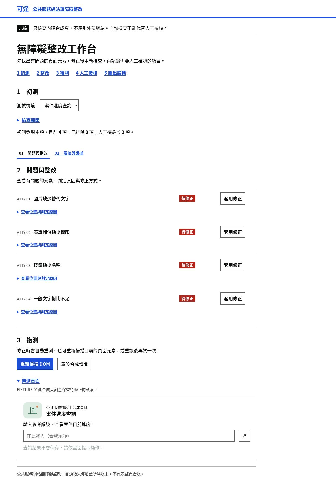
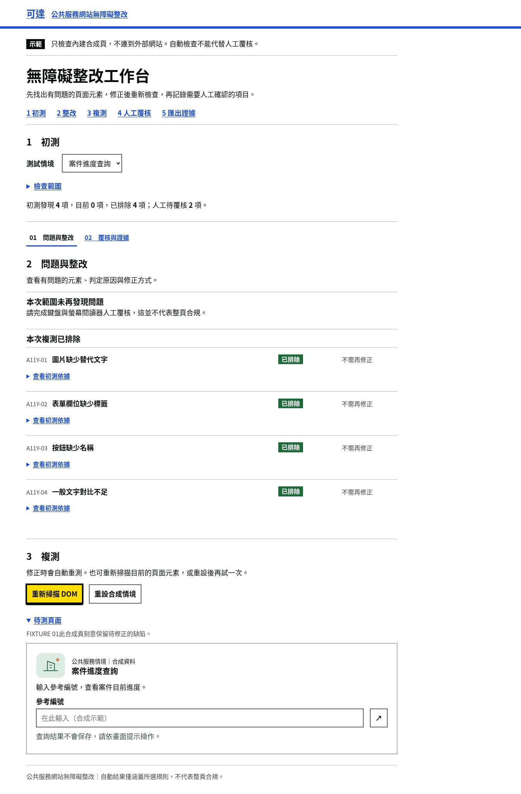
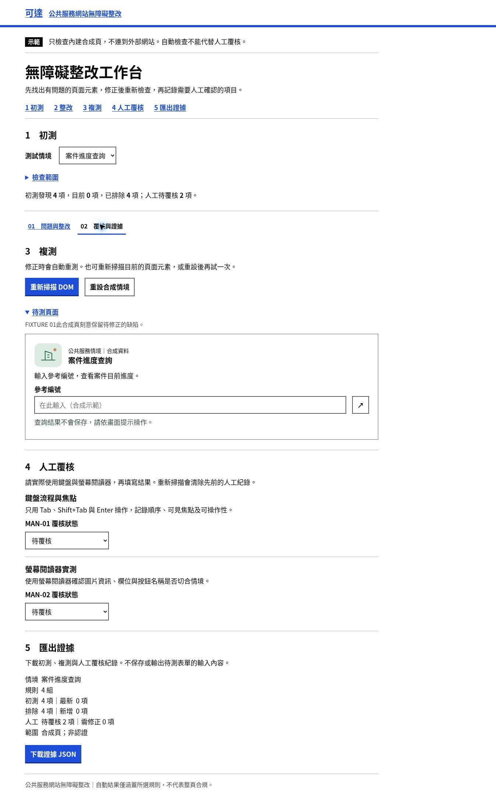

# 可達｜公共服務網站無障礙整改工作台

找出問題在頁面的哪個元素、修正後有沒有消失，以及哪些操作仍需人工覆核。用於公共服務網站改版前的檢查、整改交接與複測留存。



| 修正後重新掃描 DOM | 人工覆核與輸出證據 |
| --- | --- |
|  |  |

桌面與手機沿同一條五步流程操作；新版拉開檢查區塊、修正按鈕與欄位的距離，仍以黃底黑線標示鍵盤焦點。[390px 手機畫面](docs/assets/04-mobile.jpg)

## 怎麼用

1. **測試人員**選擇「案件進度查詢」或「場地使用申請」合成頁，確認檢查項目並建立初測基線。
2. **開發人員**依元素定位修正圖片替代文字、輸入欄位標籤、圖示按鈕名稱或文字對比。工作台直接更新合成頁 DOM，重新掃描並顯示同一基線的差異。
3. **覆核人員**另用鍵盤與螢幕閱讀器實測，填記每項狀態，再下載 JSON 留存。掃描或修改後，先前人工結果會重置為待覆核。
   
瀏覽 [實際下載的合成證據 JSON](docs/evidence-sample.json)、[需求與驗證方式](docs/REQUIREMENTS.md)、[介面設計與驗證](DESIGN.md) 或 [390px 行動版截圖](docs/assets/04-mobile.jpg)。

## 本機啟動

需 Python 3 與現代瀏覽器，不需安裝套件或登入。測試需 Node.js 20 以上。

```bash
python3 -m http.server 8080 --bind 127.0.0.1
# 開啟 http://127.0.0.1:8080/
npm test
```

檢查僅在瀏覽器處理內建合成頁，不取用外部網站、不保存表單。四項自動檢查不能涵蓋全部 WCAG 要求，也不代表取得標章。

工作台用自己的四項規則檢查實際介面，初測及匯出狀態均為 **0 項自動發現**（只掃描規則涵蓋的節點）。刻意植入缺陷的合成待測頁另算，兩個情境仍各有 4 項初測發現。
